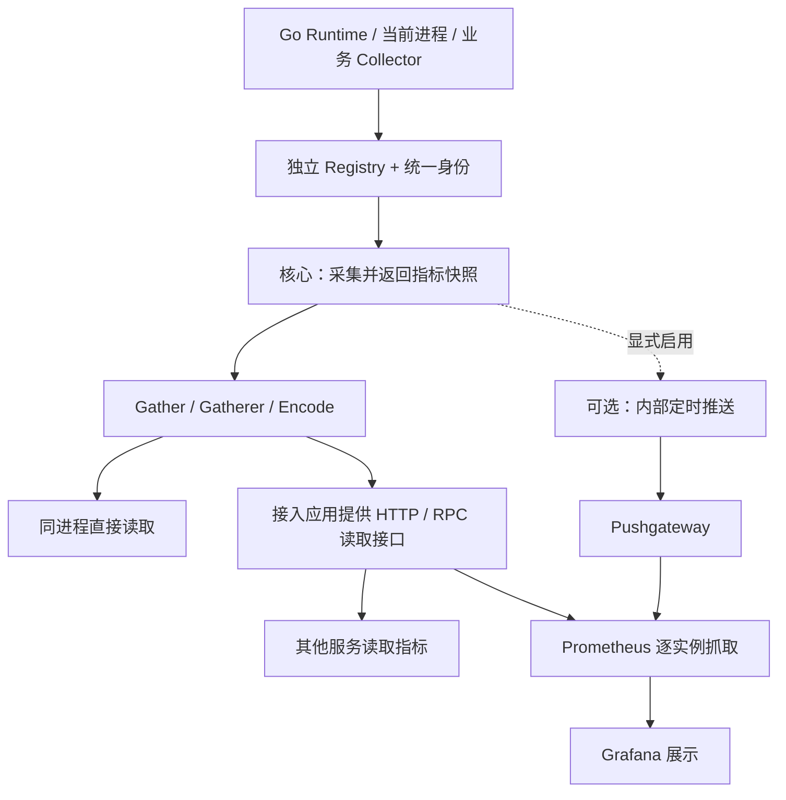

# 通用 Go Metrics SDK 技术设计

版本：v2 设计提案（采集与读取优先）。依据：[通用 Go Metrics SDK 设计讨论稿](./metrics-sdk-discussion.md)。

本文将讨论稿收敛为可实施的接口、运行契约和监控接入方案。当前已实现核心 SDK、直接读取及 HTTP 拉取示例；推送与配套部署产物仍属于设计目标，不代表已发布能力。Go module 路径为 `github.com/zgsm-sangfor/costrict-common-metrics`，实际接入说明见 [SDK 使用文档](./metrics-sdk-usage.md)。

## 1. 目标、范围与设计决策

SDK 的主要功能是**采集指标，并提供接口给接入应用或其他服务读取**。默认使用路径是初始化 SDK、按需读取指标；无需启用推送，也无需部署 Pushgateway。Prometheus/Grafana 是指标的下游消费与展示方案，不是采集功能的运行前提。

这里的 SDK 是嵌入 Go 应用的库，不是独立网络服务。同进程代码直接调用 Go 接口；其他进程或服务通过接入应用提供的 HTTP/RPC 接口读取。SDK 不自行监听端口。

| 层次 | 能力 | 优先级 |
| --- | --- | --- |
| 采集 | 默认 Go Runtime、当前进程；支持业务 Collector 注册 | 核心，必须交付 |
| 读取 | Gather 返回结构化指标、Gatherer 适配生态、Encode 编码 | 核心，必须交付 |
| 展示接入 | 应用暴露读取端点 → Prometheus 抓取 → Grafana | 首选监控接入方式 |
| 可选推送 | 通过接口启用 SDK 内部定时推送 → Pushgateway → Prometheus 抓取 | 扩展，不作为核心交付前提 |

首版使用 `prometheus/client_golang` 和独立 Registry，默认身份为必填 `app` 与“可读前缀 + 随机 UUID”的 `sdk_instance_id`。资源口径是当前 Go 进程；cgroup 和宿主机采集后续独立扩展。业务埋点由调用方负责。

SDK 不管理应用 HTTP Server、路由、信号或服务发现。默认不启动后台推送、不创建网络客户端。可选 Pushgateway 模块由 SDK 实现调度与协议适配，使用接入方注入的 HTTP Client 管理实际网络传输、认证和 TLS；无需调用方自行实现整套 Exporter。remote write 不属于本版设计范围。

## 2. 总体架构与包组织



建议包组织：

```text
metrics.go                 Config、SDK、Identity、读取接口、公开错误
encode.go                  纯数据编码
internal/identity/         名称选择、清理、UUID
internal/collection/       Registry 包装、校验、快照和自监控
pushgateway/               可选模块：Push / Start / Stop、内部调度与协议适配
examples/read/             直接读取结构化指标
examples/pull/             应用提供 HTTP 读取端点
examples/pushgateway/      可选推送接入
deploy/prometheus/        抓取配置、告警模板
deploy/grafana/           Dashboard JSON 和数据源配置
```

核心包不依赖可选推送包。建议一个进程使用一个 SDK，各读取方及可选推送模块复用同一采集入口。推送配置不进入核心 `Config`。

## 3. 公开接口

### 3.1 初始化与身份

以下类型均属于拟发布的 `metrics` 包：

```go
type Config struct {
    App               string
    InstanceID        string
    InstanceName      string
    EmitInstanceName  bool
    Labels            map[string]string
    DisableGo         bool
    DisableProcess    bool
}

type Identity struct {
    App          string
    InstanceID   string
    InstanceName string            // 最终选定并清理的名称；可能为空
    Labels       map[string]string // 实际附加到所有指标的完整静态标签
}

type SDK struct { /* private */ }

func New(cfg Config) (*SDK, error)
func (s *SDK) Identity() Identity
func (s *SDK) Registerer() prometheus.Registerer
func (s *SDK) Gatherer() prometheus.Gatherer
func (s *SDK) Gather() ([]*dto.MetricFamily, error)
func (s *SDK) Shutdown(ctx context.Context) error
```

`dto` 对应 `github.com/prometheus/client_model/go`；`prometheus` 对应 `github.com/prometheus/client_golang/prometheus`。`New` 只初始化身份、Registry 和 collector，不启动后台任务或网络连接；任一默认 collector 注册失败时整体初始化失败。

配置规则：

- `App` 去除首尾空白后必须非空。首版限制身份、静态标签值均为有效 UTF-8；单值最长 256 字节，自定义静态标签最多 16 个。
- `InstanceID` 为空时自动生成；显式提供但仅含空白视为配置错误。有效显式 ID 原样使用，不追加 UUID。
- 名称依次选择非空 `InstanceName`、`METRICS_INSTANCE_NAME`、hostname；清理到 `[A-Za-z0-9._-]`，其他字符替换为 `_`，最多 128 个字符。hostname 获取失败允许无前缀。
- 自动 ID 使用安全随机 UUID v4；生成失败返回错误，无名称时直接使用 UUID。ID 在 SDK 生命周期内不变，重新初始化默认生成新 ID。
- `EmitInstanceName=true` 且名称非空时附加 `instance_name`；否则省略。显式完整 ID 不妨碍单独选择名称。
- `Labels` 使用传统 Prometheus 标签名规则 `[a-zA-Z_][a-zA-Z0-9_]*`；拒绝 `__` 开头、`app`、`sdk_instance_id`、`instance_name`、`job` 和 `instance`。
- 静态标签还不能使用 `version`、`collector`、`reason`，避免与 SDK 自监控指标的维度重名。
- `New` 深拷贝配置，`Identity()` 返回副本；调用方修改 map 不影响运行中的 SDK。

应用应在启动日志记录 `Identity()` 中的最终 ID，避免为了确认身份解析 UUID 前缀。稳定 ID 由接入方保证在同一存储范围内只有一个活动写入者；SDK 无法跨进程验证这一点。

### 3.2 注册和读取

`Registerer()` 返回 SDK 包装器，支持标准 `Register`、`MustRegister`、`Unregister` 方法。推荐用返回错误的 `Register`；显式调用 `MustRegister` 仍遵循上游 panic 语义，SDK 自身不使用它。

| 接口 | 契约 |
| --- | --- |
| `Register(collector)` | 给业务指标统一附加身份和静态标签；描述符冲突或重复注册返回错误 |
| `Unregister(collector)` | 注销业务 collector；不能注销默认及 SDK 内部 collector |
| `Gather()` | 触发当次采集，返回独立可修改快照；不带显式样本时间戳 |
| `Gatherer()` | 返回调用同一采集入口的适配器，不能暴露可绕过校验的原始 Registry |
| 部分失败 | 同时返回可用 families 和非 nil 错误；无效样本排除，不能填 0 |
| 关闭后 | `Gather()` 返回 `ErrClosed`；注册返回 `ErrClosed`，注销返回 false；已持有的业务 Counter 可以更新但不再导出 |

采用 `WrapRegistererWith` 附加常量标签，但不将其视为全部校验。业务指标不能声明保留标签及 `Config.Labels` 中的同名标签，不能使用 `costrict_sdk_` 前缀。首版拒绝无法通过 `Describe` 枚举描述符的 unchecked collector；注册时校验可检查的描述符，采集时再次校验实际标签、类型、重复序列和显式时间戳。业务 collector 必须正确实现并发安全的 `Describe/Collect`。

注册校验不是业务维度限流器。路由标签应使用 `/orders/:id` 等模板，不使用订单 ID、用户 ID、原始 URL 或错误全文。

公开错误至少包含：

```go
var (
    ErrInvalidConfig = errors.New("metrics: invalid config")
    ErrClosed        = errors.New("metrics: closed")
    ErrGatherBusy    = errors.New("metrics: gather busy")
)
```

配置错误通过 `%w` 包装，支持 `errors.Is`。collector 错误保留可诊断原因；日志由接入方记录，指标标签不携带错误文本。

### 3.3 纯数据编码

```go
type TextFormat uint8

const (
    PrometheusText TextFormat = iota // text/plain; version=0.0.4; charset=utf-8
    OpenMetricsText                  // application/openmetrics-text; version=1.0.0; charset=utf-8
)

func ContentType(format TextFormat) (string, error)
func Encode(w io.Writer, families []*dto.MetricFamily, format TextFormat) error
```

`Encode` 不再次采集、不修改数据、不关闭调用方 Writer；未知格式报错。OpenMetrics 编码完成时写出 EOF 标记。写入失败可能已经输出部分内容，HTTP 接入若要求全有或全无，应先编码到自己的缓冲区。

SDK 不读取 Accept Header，也不设置 HTTP 状态码。接入方可用 `promhttp.HandlerFor` 处理内容协商；使用 `Encode` 时由接入方自行选择格式和响应策略。首版不承诺 native histogram、exemplar 的完整链路，业务示例采用经典 Histogram。

### 3.4 接口使用关系

| 使用方 | 调用方式 | 返回/消费内容 |
| --- | --- | --- |
| 同进程模块 | `sdk.Gather()` | `[]*dto.MetricFamily` 和采集错误 |
| 接入方 HTTP 服务 | `promhttp.HandlerFor(sdk.Gatherer(), ...)` | Prometheus/OpenMetrics 响应 |
| 接入方自定义协议 | `Gather()` 后自行转换，或 `Encode()` | 自定义 DTO 或标准指标文本 |
| 外部服务 | 请求接入应用提供的 HTTP/RPC 端点 | 接入应用约定的数据格式 |
| 可选推送模块 | 调用同一个 `sdk.Gather()` | 将采集结果发送到 Pushgateway |

`Gather` 是主要数据接口，不要求后台定时任务预先运行。外部服务需要 REST JSON 时，由接入应用定义响应 DTO 和部分失败字段，不将 protobuf Go 结构直接当成长期 REST 契约。推送接口与机制集中在第 6 节，不影响以上读取能力。

## 4. 外部项目引入与调用

### 4.1 依赖引入

代码上传并发布版本后，使用以下 module 地址引入；将 `<发布版本>` 替换为实际版本标签：

```bash
go get github.com/zgsm-sangfor/costrict-common-metrics@<发布版本>
go mod tidy
```

本地联调可在调用方 `go.mod` 增加 `replace github.com/zgsm-sangfor/costrict-common-metrics => ../costrict-common-metrics`。尚未上传仓库或发布版本时，可通过此方式联调，无需从远端下载 SDK。

### 4.2 最小拉取接入：业务自己管理 HTTP

下面展示完整应用结构。SDK 只参与初始化、注册和读取，HTTP Server、路由、退出信号均由调用方管理。生产环境应给内部指标端点配置访问控制。

```go
package main

import (
	"context"
	"errors"
	"log"
	"net/http"
	"os"
	"os/signal"
	"syscall"
	"time"

	metrics "github.com/zgsm-sangfor/costrict-common-metrics"
	"github.com/prometheus/client_golang/prometheus"
	"github.com/prometheus/client_golang/prometheus/promhttp"
)

func run() error {
	sdk, err := metrics.New(metrics.Config{
		App:              "billing-api",
		EmitInstanceName: true,
		Labels:           map[string]string{"env": "prod"},
	})
	if err != nil {
		return err
	}
	defer func() {
		ctx, cancel := context.WithTimeout(context.Background(), 10*time.Second)
		defer cancel()
		if err := sdk.Shutdown(ctx); err != nil {
			log.Printf("metrics shutdown: %v", err)
		}
	}()
	log.Printf("metrics identity: %+v", sdk.Identity())

	requests := prometheus.NewCounterVec(prometheus.CounterOpts{
		Name: "billing_http_requests_total",
		Help: "Completed business HTTP requests.",
	}, []string{"route", "method", "status"})
	latency := prometheus.NewHistogramVec(prometheus.HistogramOpts{
		Name:    "billing_http_request_duration_seconds",
		Help:    "Business HTTP request duration in seconds.",
		Buckets: []float64{0.005, 0.01, 0.025, 0.05, 0.1, 0.25, 0.5, 1, 2.5, 5},
	}, []string{"route", "method"})
	for _, c := range []prometheus.Collector{requests, latency} {
		if err := sdk.Registerer().Register(c); err != nil {
			return err
		}
	}

	mux := http.NewServeMux()
	mux.Handle("/internal/metrics", promhttp.HandlerFor(sdk.Gatherer(), promhttp.HandlerOpts{
		ErrorHandling:       promhttp.HTTPErrorOnError,
		MaxRequestsInFlight: 2,
		Timeout:             5 * time.Second,
	}))
	mux.HandleFunc("/ping", func(w http.ResponseWriter, r *http.Request) {
		started := time.Now()
		// 示例只接收 GET，避免未经约束的 method 标签。
		if r.Method != http.MethodGet {
			w.WriteHeader(http.StatusMethodNotAllowed)
			return
		}
		defer func() {
			requests.WithLabelValues("/ping", "GET", "200").Inc()
			latency.WithLabelValues("/ping", "GET").Observe(time.Since(started).Seconds())
		}()
		_, _ = w.Write([]byte("pong"))
	})

	server := &http.Server{Addr: ":9091", Handler: mux, ReadHeaderTimeout: 5 * time.Second}
	stopped, stop := signal.NotifyContext(context.Background(), os.Interrupt, syscall.SIGTERM)
	defer stop()
	serveErr := make(chan error, 1)
	go func() { serveErr <- server.ListenAndServe() }()
	select {
	case err := <-serveErr:
		if errors.Is(err, http.ErrServerClosed) {
			return nil
		}
		return err
	case <-stopped.Done():
		ctx, cancel := context.WithTimeout(context.Background(), 10*time.Second)
		defer cancel()
		return server.Shutdown(ctx)
	}
}

func main() {
	if err := run(); err != nil {
		log.Fatal(err)
	}
}
```

实际业务建议在自己的中间件中记录真实状态码和路由模板，避免把 `/internal/metrics` 抓取本身纳入业务 QPS。Gin、Echo、gRPC 等框架采用同样的注册方式，由各自接入代码决定如何采集业务信息。

`HTTPErrorOnError` 让部分失败也表现为抓取失败；如果业务选择保留部分结果，可改用 `ContinueOnError` 并配置日志与采集错误告警，此时 `up=1` 不代表所有 collector 成功。

### 4.3 不经 HTTP 直接使用指标

```go
families, gatherErr := sdk.Gather()
if gatherErr != nil {
    log.Printf("partial metrics: %v", gatherErr)
}
// 即使有部分错误也可以检查有效结果；是否输出由调用方决定。
var buf bytes.Buffer
if err := metrics.Encode(&buf, families, metrics.PrometheusText); err != nil {
    return err
}
// buf 可由调用方写文件、传给其他组件或装入自己的响应。
```

### 4.4 其他服务读取

外部服务可请求接入应用的 `GET /internal/metrics`，按响应 Content-Type 解析 Prometheus/OpenMetrics 数据。接口路径、认证、超时、限流和访问权限全部由接入应用约定；也可以将 `Gather()` 封装为既有 RPC 接口。

标准读取链路为：其他服务发起请求 → 接入应用调用 Gatherer/Gather → SDK 采集 → 接入应用返回结果。读取失败由接入应用决定状态码与重试策略，不触发 SDK 推送。Prometheus 也是这一读取链路的消费者。

无需 Prometheus 时，同进程业务仍可直接使用第 4.3 节的结构化读取；其他服务仍可读取应用暴露的数据端点。

## 5. 采集运行机制

### 5.1 一次 Gather 的处理

1. 检查生命周期，以非阻塞方式获取单个采集槽位；已有采集时立即返回 `ErrGatherBusy`，不为等待者启动新 goroutine。
2. 调用独立 Registry 的 Gather。内部包装器记录默认 Go/Process collector 可观察到的错误；业务错误统一归入有限类别。
3. 校验指标类型、标签冲突、身份、重复序列及时间戳。保留有效数据，聚合错误；不支持的进程指标允许缺失。
4. 记录本次采集完成时间、耗时及错误，直接构造/补入 SDK 自监控 families，不递归调用 Gather。
5. 深拷贝成独立结果，释放采集槽位，返回数据和错误。

`Gatherer().Gather()`、`Gather()` 和推送采样全部经过这个入口。首版不缓存默认采集结果；昂贵业务 collector 如自行缓存，必须额外提供自己的更新时间和错误指标。

标准 Collector 接口没有 context，SDK **不能安全中止阻塞的 Collect**。接入方自定义 collector 必须快速返回，外部 I/O 应在有超时的后台任务更新缓存。HTTP 超时只控制响应，不保证终止 Gather；单采集槽位用于防止慢 collector 导致采集 goroutine 无限增长。卡住的 collector 会导致后续采集返回忙错误，需要修复 collector 或重启应用。

### 5.2 数据所有权与时间

- Registry 原始返回值不直接交给外部；`Gather()` 返回的 protobuf、嵌套 map/slice 均为独立快照，调用方可自行修改。
- 一次读取的修改不能污染其他读取方或可选推送。所有输出使用同一 SDK 身份。
- 默认不给指标添加显式样本时间戳，由 Prometheus 在抓取时赋值；自定义 collector 输出显式时间戳视为错误。Pushgateway 同样不接收显式样本时间戳。
- `costrict_sdk_collection_timestamp_seconds` 的值表示 SDK 本次采集完成时刻，用于区分“存储刚抓到数据”和“应用刚完成采集”。它是普通 Gauge 值，不是样本时间戳。

### 5.3 核心自监控指标

| 指标 | 类型 | 固定语义 |
| --- | --- | --- |
| `costrict_sdk_build_info{version}` | Gauge | 固定为 1，SDK 版本集中在此 |
| `costrict_sdk_collection_timestamp_seconds` | Gauge | 本次已完成采集的 Unix 秒，部分成功也更新 |
| `costrict_sdk_collection_duration_seconds` | Gauge | 本次 Registry 读取与校验耗时，不含编码和网络传输 |
| `costrict_sdk_collection_errors_total{collector}` | Counter | 每批每类别最多加 1；类别固定为 `go/process/custom/registry` |
| `costrict_sdk_collection_skipped_total{reason}` | Counter | `busy` 表示采集槽位已占用 |

这些指标附加相同身份和静态标签。在采集结束后直接补入本次时间、耗时和错误，不通过递归 Gather 获取。无法准确归因的采集错误归入 `registry`，业务 collector 错误归入 `custom`；不能把错误全文作为标签。默认 collector 因平台不支持而省略指标时，不保证能捕获为采集错误。

### 5.4 核心生命周期

`New → Ready → Shutdown → Closed`。New 不启动周期采样；调用 Gather 时才采集。Shutdown 幂等，阻止新采集/注册并等待在途采集，超时返回 context 错误。标准 Collector 没有 context，不能强制终止不合作的 Collect。关闭后 Gather 返回 ErrClosed。

若启用可选推送，调用方先停止推送，再 Shutdown SDK。推送失败不改变 SDK 核心生命周期，其他读取方仍可继续读取。

## 6. 可选扩展：内部推送到 Pushgateway

本节为次要扩展，可在核心采集和读取交付之后实现。推送也是对外接口：调用方选择单次推送或开启内部周期机制，无需自己实现采样循环。默认不开启，也不影响核心验收。

### 6.1 可选接口与调用

以下接口属于独立 `pushgateway` 子包；其对核心只依赖 `Gather() ([]*dto.MetricFamily, error)`：

```go
// HTTPDoer 由接入方提供，通常为 *http.Client。
// 认证、TLS、代理等通过接入方的 Client/Transport 管理。
type HTTPDoer interface {
    Do(*http.Request) (*http.Response, error)
}

type Config struct {
    URL      string        // Pushgateway 地址，必填
    Job      string        // Pushgateway job 分组名，必填
    Client   HTTPDoer      // 必填，不隐式创建客户端
    Interval time.Duration // 默认 30s
    Timeout  time.Duration // 每次请求默认 5s
}

type Source interface {
    Gather() ([]*dto.MetricFamily, error)
}

type Pusher struct { /* private */ }
func New(source Source, cfg Config) (*Pusher, error)
func (p *Pusher) Push(ctx context.Context) error  // 单次采集并推送
func (p *Pusher) Start(ctx context.Context) error // 显式开启内部周期任务
func (p *Pusher) Stop(ctx context.Context) error  // 停止周期任务并取消在途请求
func (p *Pusher) Delete(ctx context.Context) error // 显式删除自己的远端分组
```

`New` 不发请求；URL 必须为有效 HTTP(S) 地址，时长负值报错。`Push` 可单独使用，已有发送时立即返回忙错误；`Start` 重复调用返回已启动错误。Start 首次立即推送，随后按 Interval 调度，不并发发送、不补采积压 tick。会话 context 取消时停止任务；Stop 幂等，停止后不再启动该 Pusher。Delete 仅在无发送活动时允许调用，使用相同超时和认证，不触发采集。

调用示意（需导入可选子包，`sdk` 为已初始化的核心 SDK）：

```go
pusher, err := pushgateway.New(sdk, pushgateway.Config{
    URL: "http://pushgateway:9091",
    Job: "billing-api",
    Client: &http.Client{Timeout: 5 * time.Second},
    Interval: 30 * time.Second,
})
if err != nil { return err }
// 只需要单次推送时调用 pusher.Push(ctx)。
if err := pusher.Start(appCtx); err != nil { return err }
// 退出时依次 pusher.Stop(shutdownCtx)、sdk.Shutdown(shutdownCtx)。
```

### 6.2 最小运行机制

一次推送为：调用 Source.Gather → 校验统一身份 → 编码 → PUT 替换自己的 Pushgateway 分组。所有输出必须具备一致的 app 和 sdk_instance_id；空结果、身份不一致或部分采集失败时返回错误，不覆盖远端完整快照。分组键固定为 `job + app + sdk_instance_id`，正确编码路径值，禁止多个活动进程共用分组。

SDK 内部实现 Pushgateway 协议，可复用 Prometheus 官方 push 包，使用注入的 Client 发请求。不使用 remote write protobuf、Snappy 或 `/api/v1/write`。Pushgateway 保存最新快照，Prometheus 随后抓取它，最后由 Grafana 查询 Prometheus。

本版扩展不设计历史批次队列、WAL 或复杂重试。单次请求失败直接返回错误；周期模式记录最近结果，下个周期重新采集并尝试，避免积压旧快照。可选提供只读 `Status()`：是否运行、最近尝试/成功时间、尝试/失败次数、最近错误；实现这些本地诊断不作为核心采集指标契约。

Push 成功只代表 Pushgateway 接收成功，不代表 Prometheus 已抓取。Stop 不隐式删除远端数据；若业务希望清理，停止发送后显式调用 Delete。SDK 不拥有也不关闭注入的客户端。

### 6.3 Prometheus 抓取 Pushgateway

```yaml
scrape_configs:
  - job_name: pushgateway
    honor_labels: true
    static_configs:
      - targets: ['pushgateway:9091']
```

`honor_labels: true` 用于保留 Pushgateway 中的 job/instance 标签；与直接抓取应用的配置分开。所有推送数据保留 SDK 的 app/sdk_instance_id。相同来源不要同时经直接抓取和 Pushgateway 导入同一查询域，以免重复统计。

Pushgateway 不随应用退出自动删除分组，随机 ID 重启会留下旧分组，需由部署方制定删除/保留规则。展示当前实例时依据采集时间新鲜度，不能仅 count(go_info)；旧分组持续被抓取时资源汇总也会包含旧值，因此应先过滤新鲜采集时间或完成清理。第 8 节默认看板以直接抓取为主，不能不加调整用于残留分组。

抓取 Pushgateway 的 `up` 只表示网关可达，不表示应用仍运行。可观察网关的 `push_time_seconds` 和 SDK 采集时间；应用停止后的判断依赖数据年龄或外部期望实例清单。应用强杀时无法保证 Delete 被执行。这些生命周期成本也是默认采用直接读取/抓取的原因。

## 7. Prometheus 接入与部署

### 7.1 推荐拉取配置

假设三个实例均监听容器内 9091，映射到宿主机 19091、19092、19093，由应用提供 `/internal/metrics`：

```yaml
global:
  scrape_interval: 15s
  evaluation_interval: 15s

scrape_configs:
  - job_name: billing-api
    metrics_path: /internal/metrics
    scrape_timeout: 5s
    honor_labels: false
    static_configs:
      - targets:
          - 'docker-host:19091'
          - 'docker-host:19092'
          - 'docker-host:19093'
        labels:
          deployment: prod-billing

rule_files:
  - /etc/prometheus/rules/metrics-sdk.yml
```

`docker-host` 替换为 Prometheus 可达的真实地址，告警规则文件见第 9 节。基础标签由 SDK 产生，抓取端不能再定义同名 `app`、`sdk_instance_id`、`instance_name`、`env`，否则 `honor_labels: false` 会产生覆盖或 `exported_*` 改名。示例的 `deployment` 是独立目标标签，可用于对 `up` 分组。

```text
# 应用 /internal/metrics 输出（数值为示意）
process_resident_memory_bytes{app="billing-api",env="prod",instance_name="worker-a",sdk_instance_id="worker-a-<UUID>"} 440401920

# Prometheus 存储时额外附加 job="billing-api"、instance="docker-host:19091"、deployment="prod-billing"
```

每个抓取端点必须稳定对应一个实例，不能只抓负载均衡地址。裸机使用独立端口或文件发现，Docker 使用可路由端点，K8s 使用 PodMonitor/ServiceMonitor/服务发现；核心 SDK 不依赖这些部署选择。

### 7.2 K8s 可选元数据注入

```yaml
env:
  - name: METRICS_INSTANCE_NAME
    valueFrom:
      fieldRef:
        fieldPath: metadata.name
```

SDK 只读取通用环境变量。需要 namespace、pod、container 等查询维度时，由应用传入 Labels 或由发现规则附加，并统一标签所有权。同 Pod 多个进程依旧生成不同 UUID。

### 7.3 端到端数据验证

1. 请求各实例 `/internal/metrics`，确认全部指标包含正确身份，同一进程多次请求 ID 不变。
2. 在 Prometheus Targets 页面确认三个端点均为 UP；查询 `count(count by (sdk_instance_id) (go_info{app="billing-api"}))`，默认应为 3。
3. 对单个实例施加负载，查询每实例 CPU/RSS，确认其他实例和应用汇总均符合实际。
4. 重启一个实例，确认新 ID 出现，旧 ID 保留在历史查询；瞬时旧数据的消失遵循拉取 staleness 规则。
5. 停止一个实例，确认对应 `up=0`；移除发现目标后 `up` 本身也会消失，需要不同的缺失告警。
6. 可选扩展另测 SDK → Pushgateway → Prometheus → Grafana，基础采集验收不依赖该扩展。

## 8. Grafana 最终展示设计

### 8.1 数据源与变量

Grafana 添加 Prometheus 数据源，URL 为 **Grafana 服务端可访问的 Prometheus 地址**，如同一 Docker 网络下 `http://prometheus:9090`；容器内 `localhost` 不是宿主机或其他容器。

基础 Dashboard 变量：

| 变量 | Grafana 配置 | 说明 |
| --- | --- | --- |
| `datasource` | Prometheus 类型数据源 | 所有面板引用它 |
| `app` | Label values，metric=`costrict_sdk_build_info`，label=`app` | 应用单选；等价旧语法 `label_values(costrict_sdk_build_info, app)` |
| `sdk_instance_id` | Label values，按 app 过滤，label=`sdk_instance_id` | 多选，All 值为 `.*`，变化后刷新 |
| 时间范围 | 默认最近 1h，刷新 15s | Prometheus 数据源抓取间隔设置为 15s |

统一选择器为 `{app="$app",sdk_instance_id=~"${sdk_instance_id:regex}"}`。实际查询不能保留模板之外的伪语法。跨环境同名应用应增加 `env` 变量，并在所有查询统一附加过滤；无 env 的部署使用基础版看板。

实例变量可能包含所选时间范围内已退出的 ID，这是历史分析所需；“当前有数据”统计必须使用 instant query。业务模块和推送模块作为默认折叠行，仅在启用时展开；静态 Dashboard JSON 不承诺自动检测所有模块并隐藏。

### 8.2 应用总览效果

以下数值仅为布局示意，不是性能测试结果：

```text
Costrict · Go 应用监控
应用 [billing-api ▾]  实例 [全部 ▾]  时间 [最近 1 小时]  刷新 [15s]

┌────────────────┬────────────────┬─────────────────┬────────────────┐
│ 近期采集实例 3 │ CPU 总量 1.24核│ 进程 RSS 920MiB │ Goroutine 386  │
└────────────────┴────────────────┴─────────────────┴────────────────┘
┌─────────────────────────────────┬─────────────────────────────────┐
│ 各实例 CPU 核数 · 折线         │ 各实例 RSS · 折线               │
├─────────────────────────────────┼─────────────────────────────────┤
│ Go 堆内存 / 分配速率 · 分面    │ Goroutine / GC 频率 · 分面      │
└─────────────────────────────────┴─────────────────────────────────┘

实例        ID         CPU     RSS       Goroutine    数据年龄
worker-a    …uuid-a    0.82核   420MiB    180          4s       [详情]
worker-b    …uuid-b    0.30核   310MiB    126          7s       [详情]
worker-c    …uuid-c    0.12核   190MiB     80          5s       [详情]
```

顶部展示聚合值，图例显示实例名与短 ID，完整 ID 保留在 tooltip 和详情链接。表格各 instant query 转为表格后按完整 `sdk_instance_id` 外连接；可选名称通过 build_info 标签补充，缺失时用 ID。点击某行，将完整 ID 和当前时间范围传到实例详情看板。

“近期采集实例”默认指采集时间距今小于 60 秒的实例，不表示业务健康或期望副本数。未来时钟、无数据应显式提示；不能把无数据映射成绿色 0。

### 8.3 面板与 PromQL

下列查询假设每个来源只进入存储一次、app 已唯一确定环境；部署存在 HA 采集时先在存储层配置去重。`$__rate_interval` 为 Grafana 内置变量，通常至少覆盖四个抓取周期。Counter 先 rate 再聚合。

| 面板 | PromQL | Grafana 单位 / 方式 |
| --- | --- | --- |
| CPU 总核数 | `sum(rate(process_cpu_seconds_total{app="$app",sdk_instance_id=~"${sdk_instance_id:regex}"}[$__rate_interval]))` | 自定义 `cores`，Stat |
| 各实例 CPU | `sum by (sdk_instance_id) (rate(process_cpu_seconds_total{app="$app",sdk_instance_id=~"${sdk_instance_id:regex}"}[$__rate_interval]))` | cores，Time series |
| RSS 总量 | `sum(process_resident_memory_bytes{app="$app",sdk_instance_id=~"${sdk_instance_id:regex}"})` | bytes IEC，Stat |
| 各实例 RSS | `process_resident_memory_bytes{app="$app",sdk_instance_id=~"${sdk_instance_id:regex}"}` | bytes IEC，Time series |
| Goroutine 总量 | `sum(go_goroutines{app="$app",sdk_instance_id=~"${sdk_instance_id:regex}"})` | 个，Stat |
| Go 活跃堆 | `go_memstats_heap_alloc_bytes{app="$app",sdk_instance_id=~"${sdk_instance_id:regex}"}` | bytes IEC |
| 分配速率 | `rate(go_memstats_alloc_bytes_total{app="$app",sdk_instance_id=~"${sdk_instance_id:regex}"}[$__rate_interval])` | B/s |
| Goroutine 趋势 | `go_goroutines{app="$app",sdk_instance_id=~"${sdk_instance_id:regex}"}` | 个 |
| GC 频率 | `rate(go_gc_duration_seconds_count{app="$app",sdk_instance_id=~"${sdk_instance_id:regex}"}[$__rate_interval])` | 次/s |
| 运行时长 | `time() - process_start_time_seconds{app="$app",sdk_instance_id=~"${sdk_instance_id:regex}"}` | seconds，详情 Stat |
| 数据年龄 | `time() - costrict_sdk_collection_timestamp_seconds{app="$app",sdk_instance_id=~"${sdk_instance_id:regex}"}` | seconds，负值提示时钟异常 |
| 采集耗时 | `costrict_sdk_collection_duration_seconds{app="$app",sdk_instance_id=~"${sdk_instance_id:regex}"}` | seconds |
| 采集错误速率 | `sum by (sdk_instance_id) (rate(costrict_sdk_collection_errors_total{app="$app",sdk_instance_id=~"${sdk_instance_id:regex}"}[$__rate_interval]))` | 次/s |

近期采集实例数（缺失时显示 No data，不自动补 0）：

```promql
count(
  max by (sdk_instance_id) (
    costrict_sdk_collection_timestamp_seconds{
      app="$app",sdk_instance_id=~"${sdk_instance_id:regex}"
    }
  ) > time() - 60
)
```

GC 平均暂停使用 Summary 的 sum/count，在窗口无 GC 时不输出结果：

```promql
1000 * rate(go_gc_duration_seconds_sum{
  app="$app",sdk_instance_id=~"${sdk_instance_id:regex}"
}[$__rate_interval])
/
(rate(go_gc_duration_seconds_count{
  app="$app",sdk_instance_id=~"${sdk_instance_id:regex}"
}[$__rate_interval]) > 0)
```

面板单位为毫秒。跨实例计算平均暂停应先分别汇总 sum 的 rate 和 count 的 rate 再相除；不能对各实例平均值简单平均，不能将 Summary quantile 聚合成全局 P99。

FD 使用率只在有效上限大于 0 时展示，单位 percent 0–100：

```promql
100 * process_open_fds{app="$app",sdk_instance_id=~"${sdk_instance_id:regex}"}
/
(process_max_fds{app="$app",sdk_instance_id=~"${sdk_instance_id:regex}"} > 0)
```

### 8.4 实例详情和可选面板

详情页依次展示：身份与 Go/SDK 版本、启动时间、CPU、RSS 与各类 Go 内存、goroutine/线程/对象/栈、GC、FD、采集状态。RSS、heap_alloc、sys_bytes 单独画线，不能堆叠成总量；CPU 默认是核数，不能没有配额就标为使用率。

业务埋点启用后增加 QPS、5xx 比例、P95/P99 延迟。以第 4 节指标为例：

```promql
# 应用 QPS。
sum(rate(billing_http_requests_total{app="$app",sdk_instance_id=~"${sdk_instance_id:regex}"}[$__rate_interval]))

# 5xx 比例：只有存在请求且窗口速率 > 0 才有定义。
# 示例 /ping 仅产生 200，因此用总请求序列构造已知的零错误率。
100 * (
  sum(rate(billing_http_requests_total{app="$app",sdk_instance_id=~"${sdk_instance_id:regex}",status=~"5.."}[$__rate_interval]))
  or
  (0 * sum(rate(billing_http_requests_total{app="$app",sdk_instance_id=~"${sdk_instance_id:regex}"}[$__rate_interval])))
) / (
  sum(rate(billing_http_requests_total{app="$app",sdk_instance_id=~"${sdk_instance_id:regex}"}[$__rate_interval])) > 0
)

# 按路由的 P95，单位秒；P99 将 0.95 换为 0.99。
histogram_quantile(0.95,
  sum by (le, route) (
    rate(billing_http_request_duration_seconds_bucket{
      app="$app",sdk_instance_id=~"${sdk_instance_id:regex}"
    }[$__rate_interval])
  )
)
```

Histogram 在相同桶边界前提下跨实例聚合。无请求时分位数可能为 NaN，显示“无请求”，不要标 0ms。应用没有业务埋点时显示“未启用”。

可选推送面板仅展示 Pushgateway 的推送时间、SDK 采集数据年龄及网关抓取状态，不加入队列占用和批次丢弃面板。基础看板不要求推送指标存在。

拉取模式单独展示 `up{job="billing-api"}` 的目标状态。`up` 没有 SDK 的 app/ID 标签：实例详情需要按 `job,instance` 与 build_info 关联，示例为：

```promql
up{job="billing-api"}
  * on (job, instance) group_left(app, sdk_instance_id)
  costrict_sdk_build_info{app="$app",sdk_instance_id=~"${sdk_instance_id:regex}"}
```

关联仅在身份序列仍存在时有效，抓取失败使其 stale 后结果可能消失。因此独立目标状态面板和 `up=0` 告警不能依赖该连接。Pushgateway 链路不使用网关的 `up` 判断发送者健康。

## 9. 告警模板

以下规则可以保存为 `/etc/prometheus/rules/metrics-sdk.yml`，阈值仅为初始示例。部署必须另行配置 Alertmanager 接收和路由，规则触发不等于通知已发送。

```yaml
groups:
  - name: metrics-sdk
    rules:
      - alert: MetricsTargetDown
        expr: up{job="billing-api"} == 0
        for: 2m
        labels:
          severity: warning
        annotations:
          summary: 'Metrics target {{ $labels.instance }} is unreachable'

      - alert: MetricsCollectionErrors
        expr: sum by (app, sdk_instance_id) (increase(costrict_sdk_collection_errors_total[5m])) > 0
        for: 2m
        labels:
          severity: warning
        annotations:
          summary: 'Collector errors on {{ $labels.sdk_instance_id }}'

      - alert: MetricsApplicationMissing
        expr: absent_over_time(costrict_sdk_collection_timestamp_seconds{app="billing-api",env="prod"}[2m])
        for: 1m
        labels:
          severity: critical
        annotations:
          summary: 'No metrics from billing-api in prod'

      - alert: MetricsFDPressure
        expr: process_open_fds / (process_max_fds > 0) > 0.8
        for: 5m
        labels:
          severity: warning
        annotations:
          summary: 'FD usage above 80% on {{ $labels.sdk_instance_id }}'
```

部署无 env 时删除对应过滤；存在多环境时其他规则也应增加环境过滤或分组。`MetricsApplicationMissing` 只能发现整个应用没有数据，不能发现三副本少了一个。逐实例缺失必须结合外部期望实例清单；随机 ID 重启后无法单靠旧 ID 判断替代关系。

数据年龄告警可用 `time() - costrict_sdk_collection_timestamp_seconds > 60`，但序列完全消失后表达式不再返回值，必须与缺失检测组合。CPU/RSS 告警按照应用预算或明确的资源配额另行设置，不给所有应用套用统一 CPU 百分比。

## 10. 指标兼容、性能与验收

### 10.1 版本和容量

SDK 发布采用语义化版本。公开 Go API、身份标签、SDK 指标名称/类型/单位/枚举属于兼容契约。升级 Go 或 client_golang 时，需对默认指标字典和看板依赖做快照对比，不能假定上游各版本指标完全一致。

每实例序列数近似为“默认序列 + 业务标签组合 × 类型展开数”。经典 Histogram 每个标签组合产生 `有限桶数 + 3` 条序列（包含 +Inf、sum、count）。例如 10 个有限桶、20 个路由、3 个方法约产生 780 条 Histogram 序列/实例，尚未包括 Counter 和默认指标。

每秒写入样本数约为 `活跃实例数 × 每实例序列数 / 采样周期秒数`。保留期唯一序列还受进程重启次数影响，UUID 每次变化会创建新的序列。测量 Gather 的 p50/p95/p99、编码体积、分配量、SDK CPU 开销和并发读取内存；此处不虚构尚未测量的性能承诺。

### 10.2 验收矩阵

| 方面 | 必测场景 | 验收结果 |
| --- | --- | --- |
| 身份 | 显式 ID、名称/环境/hostname 优先级、无名称、随机源失败 | 优先级正确；失败不降级到非唯一 ID |
| 多实例 | hostname 相同且 PID 都为 1；裸机/Docker；可选 K8s | 每个进程 ID 不同，无平台 API 权限依赖 |
| 注册 | 重复 collector、保留标签、unchecked collector、动态错误标签 | 错误显式可见，无绕过身份的输出 |
| 采集 | 默认项关闭、部分失败、慢 collector、并发读取、race 检测 | 有效指标保留；无填 0；忙请求快速失败 |
| 所有权 | 修改 Gather 返回的 protobuf、map/slice | 其他读取结果不受污染 |
| 编码 | Prometheus/OpenMetrics、EOF、Writer 错误 | 格式正确，错误传播，不接管 Writer 生命周期 |
| 外部读取 | 同进程 Gather、HTTP 端点、自定义 RPC、并发请求 | 不启用推送也能完整读取与展示 |
| 关闭 | 重复 Shutdown、在途采集、超时 | 状态符合约定，不承诺终止不合作 Collector |
| 可选 Pushgateway | 单次/周期推送、超时、分组隔离、重启残留、Delete | Prometheus 可抓取；失败不影响核心读取；独立验收 |
| 看板 | 多实例、单实例负载、重启、无 GC/无请求、平台缺失 | 口径正确，0/无数据/未启用分开展示 |
| 告警 | 抓取失败、目标移除、全部无数据、单实例缺失、推送断链 | 明确覆盖范围及外部清单依赖 |

SDK 实现阶段使用 `go test -race ./...` 验证并发；配套规则使用 `promtool check config`、`promtool check rules` 和规则单测验证。示例必须建立独立编译检查，Dashboard JSON 必须在固定 Grafana 版本真实导入并验证变量、单位、无数据及跳转行为。

### 10.3 实施拆分与交付

1. **基础采集**：Config/Identity、独立 Registry、注册校验、Gather/Encode、默认指标字典和拉取示例。
2. **监控闭环**：逐实例 Prometheus 配置、基础 Grafana Dashboard JSON、告警规则和部署说明；先验证三实例及重启场景。
3. **可选推送扩展**：Push/Start/Stop/Delete、内部周期机制、Pushgateway 示例及清理约定；不阻塞基础采集和读取的发布。
4. **扩展资源**：另行设计 cgroup 命名、resource_id、单资源单采集者、权限/无上限等规则，再增加资源面板。

发布前确认 module 路径、固定 Go/client_golang/Prometheus/Grafana 版本，产出可编译示例、版本化指标字典、可导入 Dashboard 和规则测试结果。本文明确的是整体实现目标及契约；当前核心 SDK 和读取示例已实现，其余交付状态以 README 为准。


## 11. 有资源限制时的占比展示补充

Docker/K8s 的 CPU、内存占比由可选 cgroup 资源采集提供，不能仅由默认进程指标准确得出：CPU 占比 = 同一 cgroup CPU 使用核数 / 有效 CPU 配额核数；内存占比 = 同一 cgroup 内存用量 / 有效内存上限。K8s requests、Docker CPU shares 不属于硬限制。

资源 collector 需输出独立 resource_id、累计 CPU 时间、CPU 配额、内存用量、内存上限及是否配置限制。无限额时不输出数值分母，权限不足或不支持时显示未知，不能伪装为 0% 或 100%。应处理 cgroup v1/v2、祖先限制、cpuset 与动态配额，并约定每个资源只由一个来源采集，避免跨进程重复汇总。

当前模拟环境已补充两类资源使用率趋势、限额值和限额状态，具体指标、PromQL 和三实例示例见 [演示说明](./metrics-demo.md#cpu--内存资源占比)。这补充的是展示需求和模拟验证；真实 SDK 的 cgroup collector 仍为待实现扩展。
